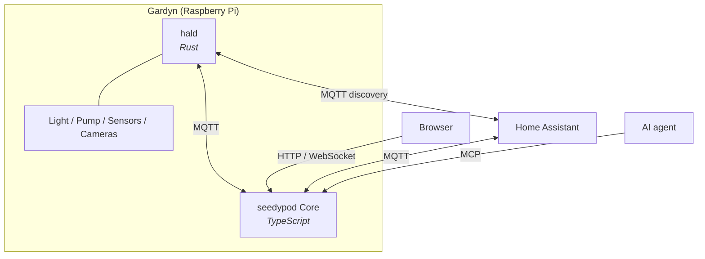

# seedypod

Local, cloud-free control for Gardyn hydroponic towers. A Gardyn already has a Raspberry Pi inside; seedypod replaces the cloud subscription with software that runs on it. No account, no telemetry, no internet required. A sibling of [sleepypod](https://github.com/sleepypod).

> **Status:** the software stack is built and tested against a simulated tower. Nothing has run on a real Gardyn yet, so the pin map is unverified until hardware bring-up.

## Repositories

### [core](https://github.com/seedypod/core)

Everything that runs on the unit. **`hald`** is a small Rust daemon that owns the pins and buses (grow light, pump, dosing pumps, water level, climate, power monitor, cameras, button). Every actuator command goes through a safety guard: bounded runs, a dry-run interlock, over-temperature cutoff and latched faults. It publishes over MQTT with Home Assistant discovery. **Core** is a Hono + tRPC server with an OpenAPI facade, an MCP endpoint, light curves, pump cycles, grow-cycle reminders, per-pod tracking, camera growth trends and a React web UI.

**Stack:** Rust, TypeScript, Hono, tRPC, React, SQLite, Drizzle, MQTT

### [seedypod.github.io](https://github.com/seedypod/seedypod.github.io)

Product guides and developer documentation: getting started, the user guide, the HAL contract, ADRs and the API reference.

## Ecosystem

Everything stays on your LAN. Neither service makes outbound connections.

## Getting Started

Read the [getting started guide](https://seedypod.github.io/getting-started/), or try the [live demo](https://seedypod.vercel.app) first. It runs the real web UI against a simulated tower in your browser.
